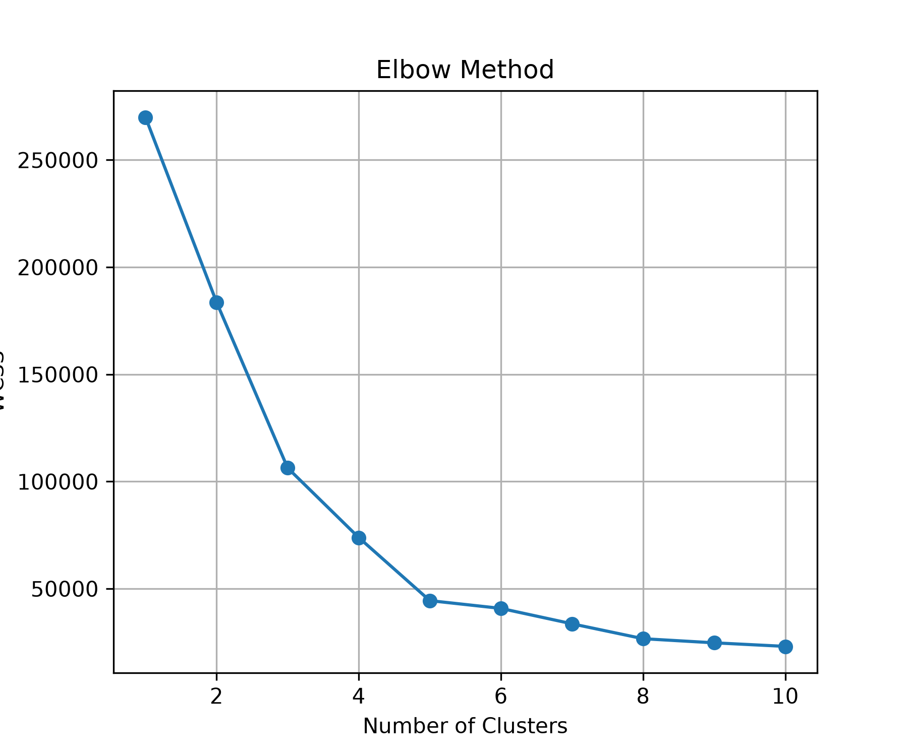
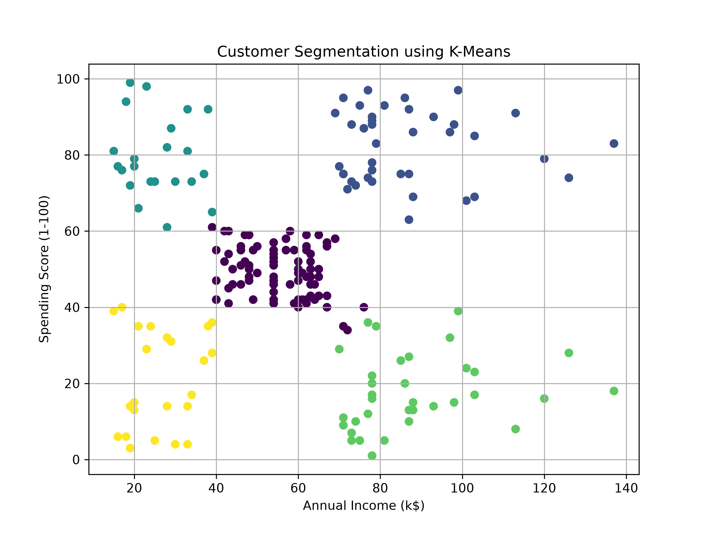

# Customer Segmentation using K-Means Clustering

## SkillCraft Technology Internship - Task 2

## Project Overview

This project uses the K-Means Clustering algorithm to group customers of a retail store into different clusters.

The clustering is done using two features:

- Annual Income (k$)
- Spending Score (1-100)

---

## Technologies Used

- Python
- Pandas
- Matplotlib
- Scikit-learn

---

## Dataset

Mall Customers Dataset

---

## Steps Performed

- Loaded the dataset
- Selected the required columns
- Used the Elbow Method
- Created the K-Means model
- Grouped customers into different clusters
- Displayed the customer segmentation graph

---

## Project Structure

```text
SCT_ML_2

│

├── data
│   └── Mall_Customers.csv

├── images
│   ├── elbow_method.png
│   └── customer_segmentation.png

├── main.py
├── README.md
├── requirements.txt
└── .gitignore
```

---

## Output

### Elbow Method



---

### Customer Segmentation

